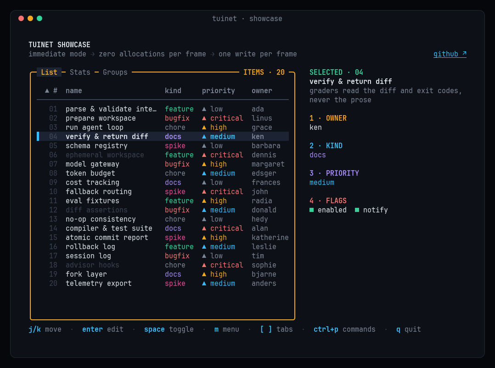
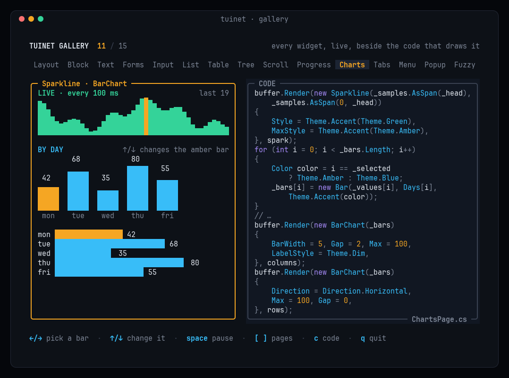

# TUI.NET

**Immediate-mode terminal UIs for .NET, built for speed.**

Redraw everything every frame and let TUI.NET send only what changed: zero allocations per frame, one `write`
per frame, Native AOT. Your app owns its state and draws it into a cell buffer each frame; there is no widget tree
to keep in sync.

| Page | What's in it |
|---|---|
| [Getting started](getting-started.md) | Install, a complete program, the frame loop, `Terminal.Run` and `IApp`, the samples |
| [Layout and styling](layout.md) | Constraint layout, colors and attributes, mixed-style text and markup, custom widgets |
| [Widgets](widgets.md) | Lists, tables, trees, scrollbars, forms, text areas, popups, tabs, menus, the command palette, progress, charts |
| [Input and the terminal](input.md) | Keys, mouse and paste, background work, title, clipboard, cursor shapes, hyperlinks, suspend, inline mode |
| [Testing](testing.md) | `TestTerminal`, styled snapshots, screen assertions, bytes on the wire |
| [Performance](performance.md) | Frame costs, how the renderer saves bytes, allocation rules, comparisons |
| [API reference](api/index.md) | Every public type and member, from the XML docs |

The source, issues and changelog are on [GitHub](https://github.com/lmaslanka/tuinet).
