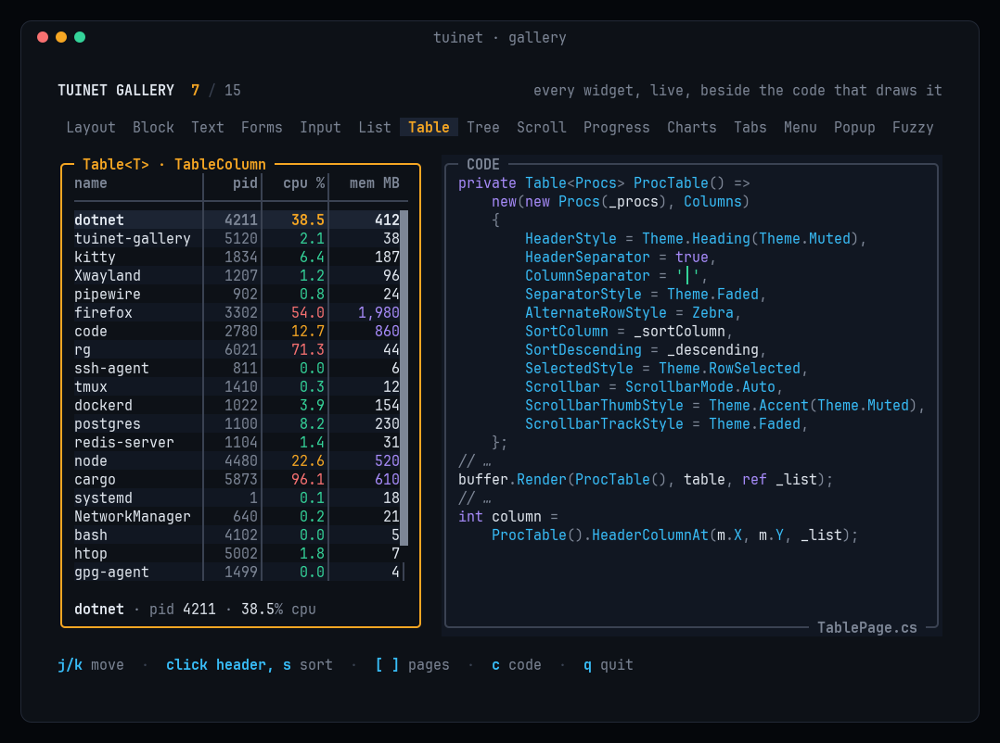

# Widgets

Widgets are stateless `readonly ref struct`s: build one, render it into an area, and it is gone. Anything that
must survive between frames (a selection, a scroll offset, the text being edited) lives in a state value your app
owns and passes in. Run `./run gallery` to see every widget next to the code that draws it.



| Widget | State | What it does |
|---|---|---|
| `Block` | | Borders (plain, rounded, double, thick, dashed), plain or styled title and footer with alignment, background, `Inner(area)` |
| `Paragraph` | | Multi-line plain or styled text with word/char wrapping, alignment and scroll; optional scrollbar; `LineCount` |
| `ListView<T>` | `ListState` | Virtualized, selectable, scrolls to follow the selection, highlight symbol, optional scrollbar; click, wheel and scrollbar drag |
| `TreeView<T>` | `TreeState` | Hierarchy with `[+]`/`[-]` expanders and `├─`/`└─` guides, lazy children, cached rows (a frame draws only what's visible), selection that follows its node; keys, click on the expander, wheel and scrollbar drag |
| `Table<T>` | `ListState` | Header and columns with constraint widths, left/center/right alignment, per-cell styles, separators, zebra stripes, sort arrow, optional scrollbar; click, wheel, scrollbar drag and header hit-testing |
| `Scrollbar` | | Vertical or horizontal, eighth-block thumb ends, `PositionAt` for clicks and drags |
| `TextInput` | `TextInputState` | Single-line editing, emacs keys, selection, undo/redo, masking, horizontal scroll, real terminal cursor; click or drag |
| `TextArea` | `TextAreaState` | Multi-line editing: soft wrap or sideways scroll, line numbers, selection, undo/redo, placeholder; click, drag and wheel; only visible lines are measured |
| `Dropdown<T>` | `DropdownState` | Select box with a popup list that flips above when there's no room below, optional shadow; click to open and pick |
| `Tabs` | `TabsState` | One-row tab bar, dividers, scrolls with `‹` `›` when the titles don't fit, fits in a block border; click and wheel |
| `Popup` | | Shadow + fill + `Block` over existing content; `Outer` sizes it from its content, `Rect.PlaceNear` places it by an anchor |
| `Menu` | `MenuState` | Popup action list: mnemonics, right-aligned shortcuts, separators joined to the border, disabled items; keys, click and hover |
| `Checkbox` | your `bool` | One-row symbol + label, or a large `Boxed` square |
| `Button` | | Padded label with idle and focused styles |
| `ProgressBar` | | Eighth-block precision, custom fill/empty glyphs (segmented meters) |
| `Sparkline` | | Values over time in eighth-block columns, several rows tall, newest on the right; draws a ring buffer's two halves without a copy |
| `BarChart` | | Vertical or horizontal bars with eighth-block ends, labels and formatted values; per-bar styles |
| `Spinner` | | Time-based frames: `Line`, `Dots`, `Arc` |
| `Clear` | | Blanks an area (`Popup` does this for you) |


## Lists

`ListView` is virtualized: it asks your `IListSource` to draw only the rows that are visible. It
handles selection, highlighting and keeping the selected row in view. The selection lives in a
`ListState` that you own.

```csharp
readonly struct Files(FileInfo[] files) : IListSource
{
    public int Count => files.Length;

    public void RenderItem(int index, Rect area, CellBuffer buffer, bool selected)
    {
        Span<char> size = stackalloc char[20];
        files[index].Length.TryFormat(size, out int n);
        buffer.SetString(area.X, area.Y, files[index].Name, default, area.Width - n - 1, Overflow.Ellipsis);
        buffer.SetString(area.Right - n, area.Y, size[..n], new Style(Color.BrightBlack, default));
    }
}
```

```csharp
var state = new ListState();   // keep this across frames

// render
frame.Render(new ListView<Files>(new Files(files))
{
    SelectedStyle = new Style(default, Color.Hex(0x1C2433), Attr.Bold),
    HighlightSymbol = "▌",
    HighlightSymbolStyle = new Style(Color.Cyan, default),
}, area, ref state);

// input
if (ev.Key.IsChar('j')) state.Next(files.Length);
if (ev.Key.IsChar('k')) state.Previous(files.Length);
if (ev.Key.Is(KeyCode.PageDown)) state.PageDown(files.Length);
if (ev.Kind == EventKind.Mouse) state.HandleMouse(ev.Mouse, files.Length);   // click selects, wheel scrolls
```

The view scrolls to the selected row whenever the selection changes. In between, it can scroll on its
own (the mouse wheel, or `state.Scroll(rows, count)`) and leave the selection off screen.

For plain strings, use the built-in `TextItems` source: `new ListView<TextItems>(new TextItems(names))`.

## Scrollbars

`ListView`, `Table` and `Paragraph` draw a scrollbar in their rightmost column with
`Scrollbar = ScrollbarMode.Auto` (only while the content is longer than the view) or `Always`. The
content gets one column less while it shows. The thumb's ends use eighth-blocks, so it moves in
eighths of a cell.

```csharp
frame.Render(new ListView<Files>(new Files(files))
{
    Scrollbar = ScrollbarMode.Auto,
    ScrollbarThumbStyle = new Style(Color.BrightBlack, default),
    ScrollbarTrackStyle = new Style(Color.Hex(0x3A4252), default),   // '│' track
}, area, ref state);
```

For lists and tables, `state.HandleMouse` also scrolls when you click or drag the scrollbar, and the
drag keeps going when the pointer leaves it. For anything else, render a `Scrollbar` yourself and map
the pointer back with `Scrollbar.PositionAt`:

```csharp
var bar = new Rect(area.Right - 1, area.Y, 1, area.Height);
frame.Render(new Scrollbar(content: lines, viewport: area.Height, position: scroll), bar);

// input: a press on the bar starts a drag that lasts until the button comes up
if (ev.Mouse.IsClickIn(bar)) dragging = true;
if (ev.Mouse.Kind == MouseKind.Up) dragging = false;
if (dragging) scroll = Scrollbar.PositionAt(bar, ev.Mouse.X, ev.Mouse.Y, lines, area.Height);
```

`Orientation = Direction.Horizontal` draws it along a row instead. A custom `ThumbChar` (or
`Smooth = false`) moves the thumb in whole cells.

## Tables

`Table` is a virtualized list with a header and columns. Column widths are layout constraints.
Each column aligns its header and cells left, center or right. Your `ITableSource` returns the text
of each visible cell: either a string you already hold, or text formatted into the `scratch` span
it is given. The table measures, aligns and clips the text, so formatting numbers stays allocation-free.
Selection uses the same `ListState` as `ListView`.

```csharp
static readonly TableColumn[] Columns =
[
    new("name", Constraint.Fill()),
    new("size", Constraint.Length(10), Alignment.Right),
    new("state", Constraint.Length(7), Alignment.Center),
];

readonly struct Files(FileInfo[] files) : ITableSource
{
    public int RowCount => files.Length;

    public ReadOnlySpan<char> Cell(int row, int column, Span<char> scratch, out Style style)
    {
        style = default;
        switch (column)
        {
            case 0:
                return files[row].Name;
            case 1:
                files[row].Length.TryFormat(scratch, out int n);
                return scratch[..n];
            default:
                style = new Style(files[row].IsReadOnly ? Color.Yellow : Color.Green, default);
                return files[row].IsReadOnly ? "ro" : "rw";
        }
    }
}

frame.Render(new Table<Files>(new Files(files), Columns)
{
    HeaderStyle = new Style(Color.BrightBlack, default, Attr.Bold),
    HeaderSeparator = true,                 // ─── under the header
    ColumnSeparator = '│',                  // drawn in the gap, joined with ┼ on the rule
    AlternateRowStyle = new Style(default, Color.Hex(0x111722)),   // zebra stripes
    SortColumn = 1, SortDescending = true,  // ▼ on "size"; the sorting itself is yours
    SelectedStyle = new Style(default, Color.Hex(0x1C2433), Attr.Bold),
    HighlightSymbol = "▌",
}, area, ref state);
```

`Table.Measure(source, column, header)` returns the widest cell in a column. Call it when the data
changes and cache the result as `Constraint.Length(width)` to size a column to its content. For rows
of strings, use the built-in `TextRows` source: `new Table<TextRows>(new TextRows(rows), columns)`.

## Trees

`TreeView` shows a hierarchy: a file tree, grouped items, an outline. Your `ITreeSource` addresses nodes by
integer ids you choose, and is asked for a node's children only once it's expanded, so a file tree can read a
directory the first time it opens. `TreeState` (a class you keep across frames) holds the expanded nodes and
caches the visible rows. They're rebuilt only when the tree's shape changes, so a frame draws only the rows on
screen, however far down a 100,000-row tree it's scrolled.

```csharp
readonly struct Folders(Folder[] folders) : ITreeSource   // ids: folder i is i, file j of folder i is 1000 * (i + 1) + j
{
    public int ChildCount(int node) => node == TreeState.Root ? folders.Length : node < 1000 ? folders[node].Files.Length : 0;
    public int Child(int node, int index) => node == TreeState.Root ? index : 1000 * (node + 1) + index;
    public bool HasChildren(int node) => node >= 0 && node < 1000;
    public int Parent(int node) => node < 1000 ? TreeState.Root : node / 1000 - 1;

    public void RenderLabel(int node, Rect area, CellBuffer buffer, bool selected) =>
        buffer.SetString(area.X, area.Y, node < 1000 ? folders[node].Name : folders[node / 1000 - 1].Files[node % 1000],
            default, area.Width, Overflow.Ellipsis);
}
```

```csharp
var tree = new TreeState();   // keep this across frames
var source = new Folders(folders);

// render
frame.Render(new TreeView<Folders>(source)
{
    GuideStyle = new Style(Color.BrightBlack, default),
    SelectedStyle = new Style(default, Color.Hex(0x1C2433), Attr.Bold),
}, area, ref tree);

// input: arrows or j/k move, → opens (then steps in), ← closes (then steps out), space toggles
if (ev.Kind == EventKind.Key && !tree.Handle(ev.Key, source) && ev.Key.Is(KeyCode.Enter)) Open(tree.SelectedNode);
if (ev.Kind == EventKind.Mouse) tree.HandleMouse(ev.Mouse, source);   // click [+]/[-] to fold, click selects
```

```
[-] src
 ├─ [+] Internal
 ├─ [-] Widgets
 │   ├─ ListView.cs
 │   └─ TreeView.cs
 └─ Terminal.cs
[+] tests
```

Nodes with children get `[+]` when collapsed and `[-]` when expanded (`CollapsedSymbol`, `ExpandedSymbol`; e.g.
`"▸ "` and `"▾ "`). `Guides = false` drops the lines. The selection follows its node when rows above it open or
close; if its parent closes, the parent is selected. `tree.Select(node, source)` opens the path to a node (with
`Parent`) and selects it, and `tree.Invalidate()` picks up data that changed or arrived later. Highlight symbol,
scrollbar, wheel and scrollbar drag work as in `ListView`, through `tree.List`.

## Forms

Interactive widgets keep their state in objects you own, so focus is just a value in your app.
There's no focus manager to fight. `FocusRing` is that value with the usual keys: Tab and Shift+Tab move it
(wrapping around), a click focuses the control under it, and `Is(i)` feeds each widget's `Focused`.

```csharp
// state, kept across frames
var focus = new FocusRing(5);                 // name, priority, notify, Save, notes (below)
var targets = new Rect[5];                    // where each control was drawn, for clicks
var name = new TextInputState("TUI.NET");
var priority = new DropdownState(selected: 1);
string[] priorities = ["low", "medium", "high"];
bool notify = true;

// render
var box = new Block { Title = " name ", BorderType = BorderType.Rounded };
frame.Render(box, nameArea);
frame.Render(new TextInput { Focused = focus.Is(0) }, box.Inner(nameArea), ref name);   // places the real cursor

var dropdown = new Dropdown<TextItems>(new TextItems(priorities))
{
    SelectedStyle = new Style(Color.Black, Color.Cyan),
    PopupBordered = true,
};
frame.Render(dropdown, pickArea, ref priority);
frame.Render(new Checkbox("notify me", notify) { Focused = focus.Is(2) }, checkArea);
frame.Render(new Button("Save") { Focused = focus.Is(3), FocusedStyle = new Style(Color.Black, Color.Green) }, buttonArea);
dropdown.RenderPopup(pickArea, frame, ref priority);   // last, so it draws on top
(targets[0], targets[1], targets[2], targets[3]) = (nameArea, pickArea, checkArea, buttonArea);

// input
if (ev.Kind == EventKind.Mouse && focus.HandleMouse(ev.Mouse, targets)) { /* clicked: focused, now use it */ }
if (ev.Kind == EventKind.Key && focus.Handle(ev.Key)) return;   // Tab, Shift+Tab
switch (focus.Current)
{
    case 0: name.Handle(ev.Key); break;                          // editing, Ctrl+W, Alt+B/F, …
    case 1: priority.Handle(ev.Key, priorities.Length); break;   // Enter opens, ↑/↓ moves, Enter picks
    case 2 when ev.Key.IsChar(' '): notify = !notify; break;
}
```

`TextInputState` supports the usual editing keys: Home/End, Ctrl+A/E, Ctrl+U/K, Ctrl+W, Ctrl/Alt+←/→,
Alt+B/F/D and Delete. It also does masking (`mask: '•'` for passwords) and paste (`Insert(string)`).
For a complete form with validation, see [`EditDialog.cs`](https://github.com/lmaslanka/tuinet/blob/main/samples/Tuinet.Samples.Showcase/EditDialog.cs).

### Multi-line text

`TextArea` edits multi-line text: descriptions, commit messages, notes. Long lines wrap at word boundaries
(or scroll sideways with `SoftWrap = false`), and it can show line numbers.

```csharp
var notes = new TextAreaState("first line\nsecond line");    // state, kept across frames

frame.Render(new TextArea { Focused = focus.Is(4), LineNumbers = true, Placeholder = "notes…" }, notesArea, ref notes);

// input
switch (ev.Kind)
{
    case EventKind.Key when ev.Key.IsCtrl('c') && notes.HasSelection: term.CopyToClipboard(notes.Selection); break;
    case EventKind.Key when focus.Is(4): notes.Handle(ev.Key); break;   // Enter is a line break; Tab is yours
    case EventKind.Mouse: notes.HandleMouse(ev.Mouse); break;           // click, drag to select, wheel
    case EventKind.Paste: notes.Insert(ev.Paste); break;                // keeps line breaks
}
```

Both editors share one editing core (`EditableText`), so both have:

- **Selection.** Shift with any movement key selects. `Selection` is the selected text, ready for
  `CopyToClipboard`; `DeleteSelection()` cuts. Typing or pasting replaces it. Dragging the mouse selects.
- **Undo and redo.** Ctrl+Z (or Ctrl+/, which also works when `SuspendOnCtrlZ` takes Ctrl+Z) and Ctrl+Y
  (or Ctrl+Shift+Z). Runs of typing undo a word at a time; undo restores the selection an edit replaced.
  The last 1000 steps are kept. `Set` and `Clear` start a new history.
- **Grapheme clusters.** The caret moves and deletes by cluster, and by word with Ctrl or Alt
  (←/→, Backspace, Delete). Offsets (`Caret`, `SelectionStart`, …) are UTF-16 indexes into `Text`.

On top of that, the text area has ↑/↓ and PageUp/PageDown by screen row (keeping the column), Home/End for the
line (Ctrl+Home/End for the text) and Ctrl+A to select all. The text lives
in a gap buffer with a line index, and a frame only measures the lines on screen, so a 100,000-line text draws
as fast as a short one. It allocates only when the text or the undo history outgrows its buffers.

## Popups and dialogs

`Popup` draws a box over whatever is already on screen: an optional drop shadow, a fill and a `Block`, in one
call. The area you give it includes the shadow, and `Outer` turns a content size into that area, so centering
on the content works:

```csharp
var popup = new Popup
{
    Block = new Block { Title = " confirm ", BorderType = BorderType.Rounded, Style = new Style(Color.Default, Color.Hex(0x111722)) },
    Shadow = true,       // darkens the cells below and right of the box, keeping their glyphs
    Padding = 1,         // one blank row and two blank columns inside the border
};
Rect dialog = frame.Area.Centered(popup.Outer(40, 3));   // 40×3 of content
frame.Render(popup, dialog);
frame.SetString(popup.Inner(dialog).X, popup.Inner(dialog).Y, "Delete 3 files?");

// input: click outside to close
if (ev.Mouse.IsClick && !ev.Mouse.IsIn(popup.Frame(dialog))) open = false;
```

`frame.Area.PlaceNear(anchor, size)` places a popup next to something instead: below it if it fits, else
above, else on the side with more room, moved left to stay on screen. Pass a 0×0 anchor for a point, such
as the mouse pointer for a context menu. `Dropdown` lists use the same rule and take `PopupShadow = true`.

## Tabs

```csharp
string[] pages = ["Files", "Search", "Settings"];
var tabs = new TabsState();                                  // state, kept across frames

var bar = new Tabs(pages)
{
    SelectedStyle = new Style(Color.Black, Color.Cyan, Attr.Bold),
    DividerStyle = new Style(Color.BrightBlack, default),   // '│' between titles
};
frame.Render(bar, new Rect(area.X + 2, area.Y, area.Width - 4, 1), ref tabs);   // e.g. in a block's top border

// input
if (ev.Kind == EventKind.Key && ev.Key.IsChar(']')) tabs.Next(pages.Length);   // wraps
if (ev.Kind == EventKind.Mouse) bar.HandleMouse(ev.Mouse, ref tabs);           // click a title, ‹ ›, wheel
```

The bar draws only the tabs and leaves the rest of the row alone, so it can sit in a `Block`'s border.
When the titles don't fit, it scrolls to keep the selected one visible and shows `‹` `›` where tabs are hidden.
`TabsState.Handle` takes ←/→ and Home/End for when the bar itself has focus. Shortcuts that switch tabs from
anywhere are yours: the showcase uses `[`/`]` and Alt+1…9, because terminals don't report Ctrl+Tab without the
kitty keyboard protocol.

## Menus and the command palette

```csharp
// Built once; '&' marks the mnemonic letter. Swap an item with `with` to change it: a struct copy, no allocation.
MenuItem[] items = [new("&Edit", "enter"), new("&Copy", "y"), MenuItem.Separator, new("&Delete", "del", Enabled: false)];
var menu = new MenuState();

// open: at the pointer (a 0×0 point) or under a row
menu.Reset(items);
Rect box = frame.Area.PlaceNear(new Rect(mouse.X, mouse.Y, 0, 0), Menu.Measure(items));

// render last, so it sits on top
frame.Render(new Menu(items) { Popup = new Popup { Shadow = true } }, box, ref menu);

// input
MenuResult result = ev.Kind == EventKind.Key ? menu.Handle(ev.Key, items) : menu.HandleMouse(ev.Mouse, items);
if (result == MenuResult.Activated) Run(menu.Selected);   // Enter, Space, a click or a mnemonic
// Cancelled: Esc, or a press outside the menu; the caller can still act on that click
```

Up/Down (and j/k) skip separators and disabled items and wrap. With `TerminalOptions.MouseMotion`, the item under
the pointer is highlighted. A menu taller than its area scrolls.

`Fuzzy.Score(pattern, text)` filters a list by what was typed: the pattern's chars must appear in order. It's -1
for no match, and higher for matches at word starts, camelCase humps and in runs. Case is ignored unless the
pattern has an uppercase letter. An overload writes the matched positions, for highlighting. Scoring 10,000 command
names takes about 0.3 ms and allocates nothing, so filter on every keystroke, only when the query changed
(`TextInputState.CopyTo` reads it without allocating). The showcase's
[`CommandPalette.cs`](https://github.com/lmaslanka/tuinet/blob/main/samples/Tuinet.Samples.Showcase/CommandPalette.cs)
puts this together with a `Popup`, a `TextInput` and a `ListView` in about 250 lines.

## Progress and animation

```csharp
var clock = Stopwatch.StartNew();

frame.Render(new ProgressBar(done / (double)total)
{
    FilledStyle = new Style(Color.Green, default),
    EmptyStyle = new Style(Color.BrightBlack, default),   // ░ remainder; eighth-blocks at the edge
}, barArea);

char spinner = Spinner.Frame(Spinner.Dots, clock.ElapsedMilliseconds);
frame.SetRune(barArea.Right + 1, barArea.Y, new Rune(spinner));

// Wake ~30×/s only while something animates; otherwise sleep until input.
bool animating = done < total;
term.Poll(out Event ev, animating ? 33 : Timeout.Infinite);
```

Base animation on elapsed time, not frame count, so it runs at the same speed whatever the frame
rate. With `Terminal.Run`, return `animating` from `IApp.IsAnimating` instead of choosing the timeout.

For something that happens once, later (hide a "saved" message after 3 seconds, run a search once typing
pauses), keep an `Alarm` in your state. It's a plain value: no timer thread, no callback.

```csharp
flash = "saved";
flashAlarm.Start(nowMs, 3000);

// IApp
public bool Handle(Event ev, long nowMs)
{
    if (flashAlarm.Fire(nowMs)) flash = "";   // true once, at the first event at or after the time
    …
}

public long NextDueMs(long nowMs) => flashAlarm.DueMs;   // Run wakes then with a Tick; long.MaxValue when not set
```
 For a segmented meter like `■■□□`, use a `ProgressBar` with `FilledChar = '■'` and `EmptyChar = '□'`.

## Charts

```csharp
// A value over time: one value per column, newest on the right. The two spans draw your own ring
// buffer without a copy (older part, then newer part); h rows give 8h levels.
frame.Render(new Sparkline(times.AsSpan(head), times.AsSpan(0, head))
{
    Style = new Style(Color.Blue, default),
    MaxStyle = new Style(Color.Yellow, default),   // the peak column
}, new Rect(x, y, 40, 3));

// Bars that compare values: vertical (labels under, values above) or horizontal (label column, values after).
Bar[] bars = [new(12, "feature", new Style(Color.Green, default)), new(7, "bugfix"), new(3, "docs")];
frame.Render(new BarChart(bars) { BarWidth = 7, ValueFormat = "0" }, chartArea);
frame.Render(new BarChart(bars) { Direction = Direction.Horizontal, Gap = 0, Max = 20 }, listArea);
```

With `Max` left at NaN, a sparkline scales to the largest *visible* value, so an old spike stops squashing
the chart once it scrolls out. Zero draws nothing, NaN and negative values leave a gap, and any other positive
value shows at least `▁`. Bar charts drop bars that don't fit instead of squashing them; values are formatted
on the stack with `ValueFormat` (`null` hides them). Keep the `Bar[]` in a field and refill it each frame:
a frame with both charts allocates nothing.

---

[Getting started](getting-started.md) · [Layout and styling](layout.md) · [Widgets](widgets.md) ·
[Input and the terminal](input.md) · [Testing](testing.md) · [Performance](performance.md) · [API reference](api/index.md)
